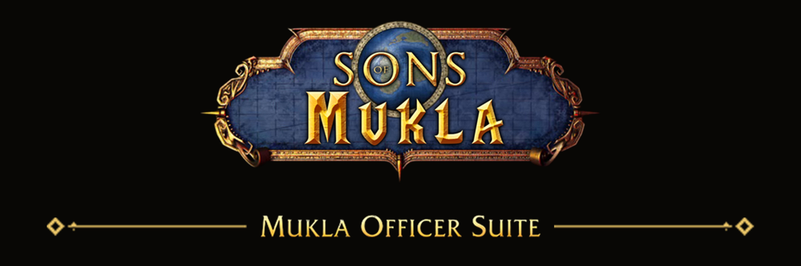

# BootyLib

BootyLib supplies the shared appearance and integration used by BootyGuild, BootyRaider, BootyProfiler, BootyActionBars and Booty Suite on World of Warcraft 1.12.

Install the `BootyLib` folder in `Interface/AddOns` alongside any Booty product. Enable it in the character's addon list. Only one copy is needed, regardless of how many Booty products are installed. The library has no separate minimap button or feature window.

Assign shortcuts under **Booty addons and tabs** in WoW Key Bindings. They open installed features with or without Suite. Each standalone product also accepts its full command (for example `/bootyguild` or `/bootyraider`) with `open`, `settings`, `about` or `versions`; existing short aliases and feature commands remain available.

When updating this development family, update BootyLib and all installed Booty
products together, then restart the client. Their shared controls require a
matching set of builds. Previous saved data and preferences are retained.

Windows, controls and menus use a consistent foreground order across installed Booty addons. The native Main Menu stays above Booty windows. Click the same Settings cog again to close Settings. A cog on another window moves the open Settings to that source immediately.

Booty Suite can open a feature in its dashboard or in a separate window. Both
presentations retain the same addon state and use the shared Settings gear.

Settings groups options under each addon name with the same icon as its menu tab. Each feature addon and Suite have separate profile lists; BootyLib does not need a profile. General appears first in Settings. A Suite profile saves a map of the selected addon profiles, saving their current settings too. Loading Suite loads those named addon profiles. Missing profiles are recreated from its backup; an addon with no selected profile gets a uniquely named BootyAddon custom profile.

BootyFrame places its complete options, search and profiles in the Frames tab.
Its preferences remain included in shared profiles from Settings.

BootyFocus places its options and profiles in the Focus tab. The shared texture
library includes six classic HUD bar styles and ten Pack styles with original
Energy, Rage and Mana fills. The styles support mirrored sides, colored fills and
replaceable circular icons for the Runic style. Recolored fills retain their
glass highlights, and decorative casings keep their complete contours. Focus
provides per-bar proportional scale and a default fill-color reset; linked size
controls update immediately when a texture or orientation changes.

Settings fields use one to four columns as space permits. Each column fits its full labels; color labels stay next to their swatches.
Mixed controls align by their bottom edges; captions stay attached to their own controls through resizing.
Related settings can share dedicated rows that wrap with the window. Multi-select dropdowns keep their menu open while choices are checked and save selections in profiles.

Resizing Settings reuses its measured labels and leaves current values and drafts intact.

Supported message settings show a full example below the text field and update it while you type. Examples wrap to fit the window.

Dropdown captions keep their normal font while windows resize. Menu choices use the same surface in both skins. Disabled text settings release keyboard focus and become read-only until enabled again.

In standalone Booty addons, use the gear in the top-right corner of a feature window to open that addon's Settings. It also works while the window is minimized.

If loading a profile or resetting Settings fails, the previous preferences are restored. The error remains visible; a failed restoration is reported separately.

If an addon cannot start or stop safely, Booty reports the reason. Failed startup cleanup must finish before another startup attempt. Feature views remain unavailable until the addon starts successfully; its Settings remains accessible.

BootyFrame offers fifteen shared decorative unit-frame styles supplied by BootyLib, including ten new black, gold, steel and violet designs with shaped bar openings. Four matching Alliance emblems are separately selectable.
The lion shield and banner are separate PvP choices. Native gold elite and silver
rare decorations can be positioned around unit portraits.
Health and resource bars fit these decorative openings, including their empty
backgrounds and mirrored shapes, while retaining the native gradient.
Their name, health and resource panels have inner shadows adapted from Blizzard's
frame artwork, so the fill blends into the decorative rim.

The new unit frames include textured name panels and separate Alliance
PvP emblems. Seven combo-point styles provide empty and lit
slots; Dark metal and Silver and gold add two selectable castbar frames, with smoother metal details at normal gameplay sizes.
Bronze ruby uses a connected five-slot frame with matching empty/lit size.
Combo artwork has clean contours prepared for small UI rendering.

BootyActionBars uses shared gryphon, lion, banner, drapery and crest ornaments supplied by BootyLib.
Moon ornaments and repaired gryphon/crystal cutouts are included. BootyFrame uses matching portrait/name glow masks for combat and resting effects.

Circular level slots retain their decorative rims and use a shared black fill.

Percentage settings display 0–100 while existing saved appearances and profiles remain compatible.

Action buttons can use rounded or circular icons, shadows and the existing project outline. Hidden styles stay inactive; previous square styles remain available.

Rounded indicators retain the icon contour while draining. Rounded outlines keep their chosen thickness as corner radius increases.

The accompanying texture library includes extracted chat skins, action-bar borders (including Fine gold rail and Border 02–15) and ornaments, and decorative unit-frame artwork for compatible Booty addons. Supplied border strips repeat their complete pattern along all four sides, with matching corners and corrected Border 08/09 orientation. Moon stone is available as a background; Parchment includes a clean gradient background and matching ornate chat border. Chat borders scale around fixed edges while the chat background keeps its position and size.

Nature XP and Azure ornaments include detailed original-source cutouts; long banners, drapery and lions retain their metal and cloth outlines.

Moon upper/lower now include detailed wide rails with smooth transparent ends. The shared library also includes repaired Azure, Nature moon, drapery and small metal ornament contours.

With current BootyProfiler installed, **Booty Diagnostics → Profile Booty** can measure selected BootyLib operations after you select the addon and press **Start**. **Stop** ends the capture. The report covers the listed Lua entry points; it does not measure total addon CPU, RAM or disk size.

Hover a top or bottom navigation tab to see its full name, including when tabs show only icons.

Common command help explains `open`, `settings`, `about` and `versions`. Chat messages identify their owner as `[BootySuite]` in the dashboard or the standalone addon name, such as `[BootyRaider]`.

Native game dialogs, including the logout countdown, stay above Booty windows.

Standalone and detached feature windows use the same resize behavior as Suite, apply the final size on release and remember it for the next opening.

Press a page keybinding again to close the same open page. If its window is minimized, the binding restores it. Opening a different page still selects that page.

Restoring a minimized dashboard lays out its content before refreshing the active page, so the page returns immediately rather than showing a scrollbar while waiting for its first repaint.

Item lists keep complete loot dates and times visible and distinguish timestamp context in project gold. Switching back to another item list restores its normal context color.
